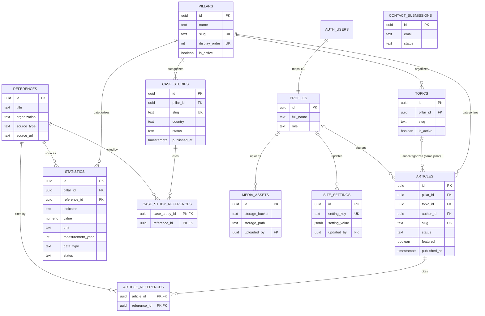

# Database Architecture — THE LIVING EARTH

**Tagline:** *A Journey Through Our Changing Planet*  
**Phase:** 2 — Database Architecture, Schema Design & Security

---

## 1. Database Overview

The database for **THE LIVING EARTH** stores structured environmental editorial content, scientific indicators, verifiable institutional references, case studies, media metadata, public contact submissions, and administrative settings. It is designed to separate public read-only editorial consumption from trusted administrative authoring through PostgreSQL constraints and Supabase Row Level Security (RLS).

---

## 2. Technology and Architecture Decisions

- **Engine:** Supabase PostgreSQL (no external ORM such as Prisma or Drizzle; managed through ordered SQL migrations and `@supabase/supabase-js` / `@supabase/ssr`).
- **Authentication:** Supabase Auth (`auth.users`) paired with `public.profiles` for single-role (`admin`) authorization. Public signup is disabled (`enable_signup = false` in `supabase/config.toml`).
- **Content Storage Format:** Markdown `TEXT` for `articles.content` and `case_studies.content` rather than premature block-editor JSON schemas.
- **Scientific Integrity by Schema:** Every `statistics` row requires a foreign key to `pillars` and `references`, numeric `value`, explicit `unit`, `geographic_scope`, `measurement_year` separated from `publication_date`, and explicit `data_type` (`historical_observation`, `current_estimate`, `projection`).
- **Delete Safety:** `ON DELETE CASCADE` is reserved for `profiles` → `auth.users` and citation join tables (`article_references`, `case_study_references`). Core entities use `ON DELETE RESTRICT` (e.g., `pillars`, `topics`, `references`) or `ON DELETE SET NULL` (`author_id`, `uploaded_by`, `updated_by`) to prevent accidental data loss.

---

## 3. Table Descriptions

| Table | Purpose | Public Access |
|---|---|---|
| `profiles` | Application metadata and `admin` role mapped 1:1 to `auth.users` | None |
| `pillars` | Five permanent environmental content pillars | Read active rows |
| `topics` | Subtopics organized under each pillar | Read active rows under active pillars |
| `articles` | Editorial and educational stories in Markdown | Read `published` rows with `published_at <= now()` |
| `case_studies` | Real-world conservation/restoration cases with location metadata | Read `published` rows with `published_at <= now()` |
| `references` | Centralized scientific and institutional sources | Read rows cited by published content |
| `article_references` | Many-to-many links between articles and references | Read links for published articles |
| `case_study_references` | Many-to-many links between case studies and references | Read links for published case studies |
| `statistics` | Environmental indicators with units, years, and limitations | Read `published` rows |
| `media_assets` | Metadata and alt text for files in Supabase Storage | None (`admin`-only metadata) |
| `contact_submissions` | Messages from the public contact form | Insert-only (`status = 'unread'`) |
| `site_settings` | Configurable non-secret website settings (`JSONB`) | None (`admin`-only) |

---

## 4. Column Definitions & Constraints

### `public.profiles`
- `id` (`UUID`, PK, FK → `auth.users.id ON DELETE CASCADE`)
- `full_name` (`TEXT`, `NOT NULL`, length 1–120)
- `avatar_url` (`TEXT`, nullable, non-empty when present)
- `role` (`TEXT`, `NOT NULL`, `CHECK (role IN ('admin'))`, no default)
- `created_at`, `updated_at` (`TIMESTAMPTZ`, `NOT NULL`, UTC `now()`)

### `public.pillars`
- `id` (`UUID`, PK, `gen_random_uuid()`)
- `name` (`TEXT`, `NOT NULL`, length 2–120)
- `slug` (`TEXT`, `NOT NULL`, `UNIQUE`, kebab-case regex)
- `description` (`TEXT`, `NOT NULL`, non-empty)
- `cover_image_path` (`TEXT`, nullable)
- `display_order` (`INTEGER`, `NOT NULL`, `UNIQUE`, `>= 1`)
- `is_active` (`BOOLEAN`, `NOT NULL`, default `true`)
- `created_at`, `updated_at` (`TIMESTAMPTZ`)

### `public.topics`
- `id` (`UUID`, PK)
- `pillar_id` (`UUID`, `NOT NULL`, FK → `pillars.id ON DELETE RESTRICT`)
- `name` (`TEXT`, `NOT NULL`, length 2–120)
- `slug` (`TEXT`, `NOT NULL`, kebab-case, `UNIQUE (pillar_id, slug)`)
- `description` (`TEXT`, `NOT NULL`)
- `display_order` (`INTEGER`, `NOT NULL`, `>= 1`)
- `is_active` (`BOOLEAN`, `NOT NULL`, default `true`)
- `created_at`, `updated_at` (`TIMESTAMPTZ`)
- Composite unique key `(id, pillar_id)` enables cross-table pillar consistency on `articles`.

### `public.articles`
- `id` (`UUID`, PK)
- `pillar_id` (`UUID`, `NOT NULL`, FK → `pillars.id ON DELETE RESTRICT`)
- `topic_id` (`UUID`, nullable; composite FK `(topic_id, pillar_id)` → `topics(id, pillar_id) ON DELETE RESTRICT`)
- `title` (`TEXT`, `NOT NULL`, length 3–200)
- `slug` (`TEXT`, `NOT NULL`, `UNIQUE`, kebab-case)
- `excerpt`, `content` (`TEXT`, `NOT NULL`, non-empty)
- `cover_image_path` (`TEXT`, nullable)
- `author_id` (`UUID`, nullable, FK → `profiles.id ON DELETE SET NULL`)
- `status` (`TEXT`, `NOT NULL`, default `'draft'`, `CHECK (status IN ('draft', 'published', 'archived'))`)
- `featured` (`BOOLEAN`, `NOT NULL`, default `false`)
- `seo_title` (`TEXT`, nullable, `<= 160` chars), `seo_description` (`TEXT`, nullable, `<= 320` chars)
- `published_at` (`TIMESTAMPTZ`, nullable; `CHECK (status <> 'published' OR published_at IS NOT NULL)`)
- `created_at`, `updated_at` (`TIMESTAMPTZ`)

### `public.case_studies`
- `id` (`UUID`, PK)
- `pillar_id` (`UUID`, `NOT NULL`, FK → `pillars.id ON DELETE RESTRICT`)
- `title` (`TEXT`, `NOT NULL`), `slug` (`TEXT`, `NOT NULL`, `UNIQUE`, kebab-case)
- `summary`, `content`, `country` (`TEXT`, `NOT NULL`)
- `region`, `cover_image_path`, `organization` (`TEXT`, nullable)
- `latitude` (`NUMERIC(9,6)`, `-90..90`), `longitude` (`NUMERIC(9,6)`, `-180..180`), paired via `CHECK`
- `start_date`, `end_date` (`DATE`, nullable; `end_date >= start_date`)
- `status` (`TEXT`, `NOT NULL`, `'draft' | 'published' | 'archived'`)
- `published_at` (`TIMESTAMPTZ`, nullable; required when `status = 'published'`)
- `created_at`, `updated_at` (`TIMESTAMPTZ`)

### `public.references`
- `id` (`UUID`, PK)
- `title`, `organization` (`TEXT`, `NOT NULL`)
- `source_type` (`TEXT`, `NOT NULL`, `'scientific_journal' | 'research_report' | 'government_data' | 'international_organization' | 'institutional_report' | 'other'`)
- `author`, `notes` (`TEXT`, nullable)
- `publication_date` (`DATE`, nullable)
- `source_url` (`TEXT`, `NOT NULL`, HTTP/HTTPS regex)
- `accessed_at` (`TIMESTAMPTZ`, `NOT NULL`, default `now()`)
- `created_at`, `updated_at` (`TIMESTAMPTZ`)
- `UNIQUE (title, source_url)` to discourage duplicate source entries.

### `public.article_references` & `public.case_study_references`
- `article_id` / `case_study_id` (`UUID`, FK `ON DELETE CASCADE`)
- `reference_id` (`UUID`, FK → `references.id ON DELETE RESTRICT`)
- `created_at` (`TIMESTAMPTZ`)
- Composite primary key `(article_id, reference_id)` / `(case_study_id, reference_id)`.

### `public.statistics`
- `id` (`UUID`, PK)
- `pillar_id` (`UUID`, `NOT NULL`, FK → `pillars.id ON DELETE RESTRICT`)
- `reference_id` (`UUID`, `NOT NULL`, FK → `references.id ON DELETE RESTRICT`)
- `indicator`, `unit`, `geographic_scope` (`TEXT`, `NOT NULL`)
- `value` (`NUMERIC`, `NOT NULL`)
- `measurement_year` (`INTEGER`, `NOT NULL`, `1800..2150`)
- `publication_date` (`DATE`, nullable)
- `methodology`, `limitations` (`TEXT`, nullable)
- `data_type` (`TEXT`, `NOT NULL`, `'historical_observation' | 'current_estimate' | 'projection'`)
- `status` (`TEXT`, `NOT NULL`, `'draft' | 'published' | 'archived'`)
- `created_at`, `updated_at` (`TIMESTAMPTZ`)

### `public.media_assets`
- `id` (`UUID`, PK)
- `file_name`, `storage_bucket`, `storage_path`, `mime_type` (`TEXT`, `NOT NULL`)
- `file_size` (`BIGINT`, `NOT NULL`, `> 0`)
- `alt_text` (`TEXT`, nullable)
- `uploaded_by` (`UUID`, nullable, FK → `profiles.id ON DELETE SET NULL`)
- `created_at` (`TIMESTAMPTZ`)
- `UNIQUE (storage_bucket, storage_path)`

### `public.contact_submissions`
- `id` (`UUID`, PK)
- `name` (`TEXT`, `NOT NULL`, 2–120 chars)
- `email` (`TEXT`, `NOT NULL`, 5–254 chars + format check)
- `subject` (`TEXT`, `NOT NULL`, 3–200 chars)
- `message` (`TEXT`, `NOT NULL`, 10–5000 chars)
- `status` (`TEXT`, `NOT NULL`, default `'unread'`, `'unread' | 'read' | 'replied' | 'archived'`)
- `created_at`, `updated_at` (`TIMESTAMPTZ`)

### `public.site_settings`
- `id` (`UUID`, PK)
- `setting_key` (`TEXT`, `NOT NULL`, `UNIQUE`, snake_case)
- `setting_value` (`JSONB`, `NOT NULL`, default `'{}'`)
- `description` (`TEXT`, nullable)
- `updated_by` (`UUID`, nullable, FK → `profiles.id ON DELETE SET NULL`)
- `created_at`, `updated_at` (`TIMESTAMPTZ`)

---

## 5. Entity Relationships & 6. Mermaid ERD



---

## 7. Index Strategy

Indexes are created in `20261113000600_create_indexes_and_triggers.sql` specifically for production query paths and foreign-key joins:

- `idx_topics_pillar_active_order`: Active topics per pillar ordered for navigation.
- `idx_articles_status_published_at`: Public article listing ordered by latest `published_at`.
- `idx_articles_pillar_topic_status`: Filtering published articles by pillar and optional topic.
- `idx_articles_featured_published` (partial `WHERE status = 'published'`): Homepage featured stories lookup.
- `idx_articles_author_id`: Admin author joins.
- `idx_case_studies_status_published_at`, `idx_case_studies_pillar_status`: Published case study listings and pillar filters.
- `idx_references_organization`: Admin reference search/filtering by institution (UNEP, NASA, IPCC, etc.).
- `idx_article_references_reference_id`, `idx_case_study_references_reference_id`: Reverse lookup from a reference to citing content.
- `idx_statistics_pillar_year_status`, `idx_statistics_reference_id`: Pillar statistic charts by year and reference join.
- `idx_contact_submissions_status_created_at`: Admin inbox sorted by unread/newest.
- `idx_media_assets_uploaded_by`: Admin media audit.

Unique constraints automatically back lookups on `pillars.slug`, `pillars.display_order`, `topics(pillar_id, slug)`, `articles.slug`, `case_studies.slug`, `media_assets(storage_bucket, storage_path)`, and `site_settings.setting_key`.

---

## 8. Trigger Strategy

A single reusable `public.set_updated_at()` function (`SET search_path = public`) updates `updated_at = timezone('utc', now())` on `BEFORE UPDATE` for all mutable tables (`profiles`, `pillars`, `topics`, `articles`, `case_studies`, `references`, `statistics`, `contact_submissions`, `site_settings`). Immutable/append-only tables (`article_references`, `case_study_references`, `media_assets`) omit `updated_at` and therefore do not carry update triggers.

---

## 9. RLS Policy Overview & Security Test Matrix

RLS is enabled on all 12 tables in `20261113000700_enable_rls_and_create_policies.sql`.  
Authorization uses `public.is_admin()`:
- Implemented as `STABLE SECURITY DEFINER` with `SET search_path = public, pg_temp`.
- Checks `EXISTS (SELECT 1 FROM public.profiles WHERE id = auth.uid() AND role = 'admin')`.
- `EXECUTE` is revoked from `PUBLIC` and granted only to `authenticated`; all admin policies are scoped `TO authenticated`.

| Action | Anonymous | Authenticated Non-Admin | Admin |
|---|---|---|---|
| Read active pillars / topics | Allowed | Allowed | Allowed |
| Read published articles / case studies / statistics | Allowed | Allowed | Allowed |
| Read references cited by published content | Allowed | Allowed | Allowed |
| Read draft or archived content | Denied | Denied | Allowed |
| Create / update / delete editorial content | Denied | Denied | Allowed |
| Read / update `profiles` | Denied | Self read only (no role change) | Allowed (`role = 'admin'` enforced) |
| Submit contact form (`status = 'unread'`) | Allowed | Allowed | Allowed |
| Read / update / delete contact submissions | Denied | Denied | Allowed |
| Read / write `media_assets` metadata | Denied | Denied | Allowed |
| Upload / update / delete Storage objects | Denied | Denied | Allowed |
| Read / modify `site_settings` | Denied | Denied | Allowed |

---

## 10. Admin Bootstrap Instructions

1. Ensure public signup remains disabled in Supabase Dashboard (**Authentication → Providers / Sign In → Disable Signups**) and in `supabase/config.toml` (`enable_signup = false`).
2. Create the initial administrator account manually in **Supabase Dashboard → Authentication → Users → Add User** (do not hardcode credentials in migrations or seed files).
3. Copy the created user's UUID from `auth.users` and insert their profile via the **Supabase SQL Editor** (trusted privileged context):
   ```sql
   INSERT INTO public.profiles (id, full_name, role)
   VALUES ('<AUTH_USER_UUID>', '<ADMIN_DISPLAY_NAME>', 'admin');
   ```
4. Verify that `profiles` has no `INSERT` policy for `anon` or regular `authenticated` users so no visitor can self-assign `admin`.

---

## 11. Storage Bucket Configuration

Configured in `20261113000800_configure_storage.sql`:

| Bucket | Public Read | Size Limit | Allowed MIME Types | Path Convention |
|---|---|---|---|---|
| `article-images` | Yes | 5 MiB | JPEG, PNG, WebP, AVIF | `article-images/{article-id}/{filename}` |
| `case-study-images` | Yes | 5 MiB | JPEG, PNG, WebP, AVIF | `case-study-images/{case-study-id}/{filename}` |
| `pillar-images` | Yes | 5 MiB | JPEG, PNG, WebP, AVIF | `pillar-images/{pillar-id}/{filename}` |
| `site-assets` | Yes | 5 MiB | JPEG, PNG, WebP, AVIF, SVG | `site-assets/{filename}` |

**Public bucket access vs. upload permissions:** Marking a bucket `public = true` only allows unauthenticated `GET`/download requests to serve images on public pages (`SELECT` policy on `storage.objects`). All `INSERT`, `UPDATE`, and `DELETE` operations on `storage.objects` require `authenticated` role + `public.is_admin()`.

---

## 12. Migration & 13. Seed Data Instructions

### Local Supabase CLI Setup (when Docker is available)
1. Install Supabase CLI (or run via `npx supabase@latest`) and start Docker Desktop.
2. Start local Supabase stack and apply migrations + seed:
   ```bash
   npx supabase start
   npx supabase db reset
   ```
   (`db reset` applies `supabase/migrations/*.sql` in timestamp order followed by `supabase/seed.sql`.)

### Remote Project Setup (only after explicitly linking)
1. Link your project:
   ```bash
   npx supabase link --project-ref <your-project-ref>
   ```
2. Push migrations:
   ```bash
   npx supabase db push
   ```
3. Run `supabase/seed.sql` via the SQL Editor or CLI to populate the five permanent pillars (`ON CONFLICT (slug) DO UPDATE` makes it idempotent).

---

## 14. Type Generation Instructions

`src/types/database.ts` currently holds provisional hand-aligned TypeScript definitions because no local Docker/PostgreSQL instance was running during Phase 2. Once migrations are applied:

```bash
npx supabase gen types typescript --local > src/types/database.ts
```

Or from your linked remote project:

```bash
npx supabase gen types typescript --project-id <your-project-ref> > src/types/database.ts
```

---

## 15. Intended Query Patterns

1. **Homepage featured articles:** Query `articles` where `status = 'published' AND featured = true` ordered by `published_at DESC`, joining `pillars(name, slug)` (backed by `idx_articles_featured_published`).
2. **Articles by pillar:** Resolve `pillars` by `slug`, then query `articles` where `pillar_id = :id AND status = 'published'` optionally filtered by `topic_id`, ordered by `published_at DESC` (backed by `idx_articles_pillar_topic_status`).
3. **Article detail by slug:** Query `articles` by `slug` (`UNIQUE`) joining `pillars`, `topics`, and `article_references(references(*))`.
4. **Published case studies:** Query `case_studies` where `status = 'published'` ordered by `published_at DESC`, optionally filtered by `pillar_id` (backed by `idx_case_studies_status_published_at` / `idx_case_studies_pillar_status`).
5. **Statistics by pillar and year:** Query `statistics` where `pillar_id = :id AND status = 'published'` ordered by `measurement_year DESC`, joining `references(*)` (backed by `idx_statistics_pillar_year_status`).
6. **Public reference listings for published content:** Query `references` directly (RLS automatically restricts results to references cited by published articles, case studies, or statistics).
7. **Admin content management:** Authenticated admin queries `articles`, `case_studies`, `statistics`, `references`, `pillars`, `topics`, `media_assets`, and `site_settings` across all statuses (`draft`, `published`, `archived`) authorized by `public.is_admin()`.
8. **Contact submission management:** Public form inserts into `contact_submissions` with `status = 'unread'`; admin queries `contact_submissions` filtered by `status` ordered by `created_at DESC` (backed by `idx_contact_submissions_status_created_at`).

---

## 16. Security Considerations & Future Expansion

- **Key Hygiene:** Never place `service_role` / `sb_secret_*` keys into `NEXT_PUBLIC_*` environment variables. Only the public `anon` / `sb_publishable_*` key may appear in `NEXT_PUBLIC_SUPABASE_ANON_KEY`.
- **Server-Side Contact Protection:** Because `contact_submissions` allows anonymous `INSERT`, Phase 3/4 should route submissions through a Next.js Server Action or Route Handler enforcing Zod validation, honeypot checks, and rate limiting.
- **Future Expansion:** Adding multi-editor/reviewer roles later only requires expanding the `profiles.role` `CHECK` constraint, introducing role-specific helper functions, and refining `draft`/`review` RLS policies without redesigning core content tables.
